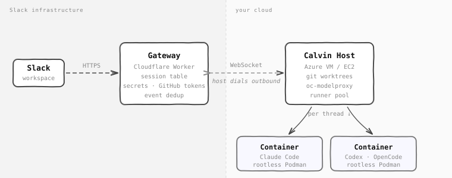
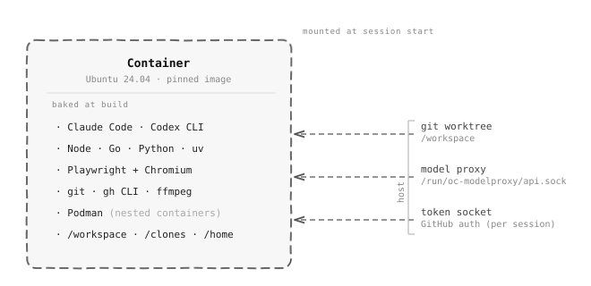
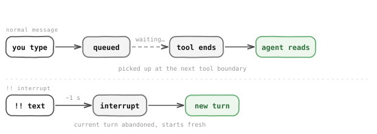
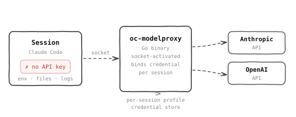

# How OpenComputer Runs Agents

**Short answer:** each Slack thread gets its own rootless **Podman container** on a Linux VM you own.  
Not micro-VMs — containers. QEMU/KVM VMs exist in the platform layer (for SDK users), not in the Slack path.

---

## The Big Picture

A Slack message lands at the **Gateway** (Cloudflare Worker). The **Calvin host** (your Azure VM or EC2 instance) dials *outbound* to the gateway over WebSocket — no inbound ports needed. Each `@Computer` mention gets its own container; the host forks a git worktree per thread so sessions never touch each other's files.

---

## What's Inside a Container

Each session starts from a pinned OCI image (`ghcr.io/diggerhq/computer-session`) baked with the full dev toolchain. The host mounts three things into the container at session start: this thread's git worktree, the model proxy socket, and the GitHub token socket. Nothing from other sessions is reachable.

---

## Steering Mid-Task

A message you send while the agent is running a tool is **queued** — it arrives after the current tool call finishes. `!! text` is the hard interrupt: the agent stops within ~1 second and starts a fresh turn with your text.

---

## Credentials Never Touch the Session

No session ever holds an API key. All model calls go through **oc-modelproxy** — a Go binary running socket-activated on the host — which binds the right credential profile per session. The key never appears in the session's environment, files, or logs.
